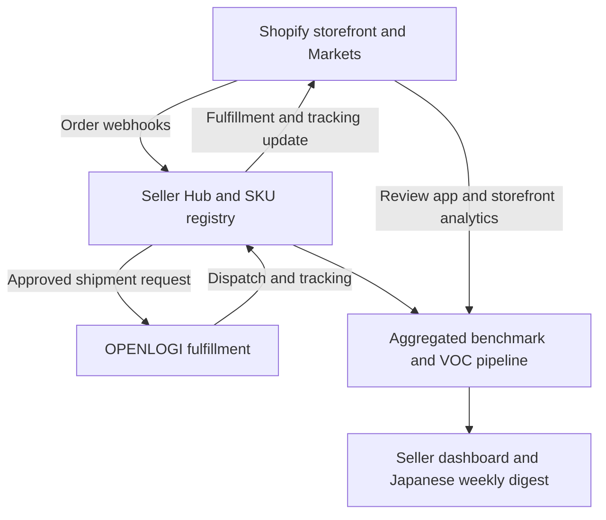

# Cross-Border Seller Hub

**Shopify × OPENLOGI fulfillment and AI market intelligence for Japanese tea and regional food producers.**

Regional producers can start with a single overseas storefront and a repeatable fulfillment process. As participating sellers build transaction, shipping, and review history, the platform can turn that data into category benchmarks and product recommendations.

The first lane is Japan → United States for shelf-stable, single-ingredient tea. Matcha, sencha, and hōjicha provide a starting point for measuring repeat purchase and testing bundles. Taiwan, Singapore, the United Kingdom, and regional foods follow lane- and SKU-specific review. Treat a 28-day replenishment cycle and USD 30–80 premium pricing as hypotheses to test with sellers.

## Try the prototype

Open [prototype/index.html](prototype/index.html) in a browser. It runs using embedded sample data and has no build step. If you prefer a local server, run this at the repository root and visit `http://localhost:8000/prototype/`.

```sh
python3 -m http.server 8000
```

1. In **Fulfillment**, open shipment **SH-101**. Orders **#1048** and **#1049** share a seller, customer, destination address, shipping service, duty treatment, and currency. The first order opens a 12-hour consolidation window. A later order for the same Seattle buyer appears in a separate parcel.
2. Open **Invoice preview** and check the English item descriptions, origin, tariff references, quantities, weights, and declared totals. Advance the demo clock to close the hold, then simulate dispatch. A single simulated tracking number is assigned to the parcel and its Shopify orders.
3. Open **SH-104** to see a regional condiment held for customs review. Use **SKU registry** to inspect the sample product records.
4. In **Benchmarks**, compare mock AOV, conversion, 60-day repeat rate, and freight-to-GMV ratios by market. Singapore demonstrates cohort suppression. The Japanese seller digest uses illustrative bundle, review, and freight findings.

The browser stores simulated dispatch and clock progress locally when storage is available. **Reset demo** restores the starting state. The prototype does not contact Shopify, OPENLOGI, customs, carriers, or an LLM. Its addresses, carrier estimates, tracking numbers, and merchant data are fictional.

## Proposed architecture



- **Storefront** — Local currencies, bundles, checkout contact details, and lane-specific DDP or DAP.
- **Seller Hub** — Validate SKU and customs metadata, use the earliest eligible order to start a 12-hour hold, consolidate matching orders within a seller, and calculate a route and parcel weight.
- **Fulfillment** — Verify OPENLOGI warehouse eligibility for food, lot and expiry controls, FEFO (first-expired, first-out), tracking, and invoice/waybill workflows for each carrier and service.
- **Analytics** — Compare anonymized category cohorts by market and period. Generate Japanese digests on co-purchases, multilingual review themes, and freight costs. Test pricing recommendations against seller margins.

### Production integration rules

- Verify Shopify HTTPS webhook signatures on the raw body, deduplicate by shop and event ID, persist events before processing, and reconcile order edits, cancellations, and fulfillment changes. Pin a supported Admin GraphQL version. Use a single writer for warehouse requests to avoid native connector and middleware double dispatch. [Shopify webhook verification](https://shopify.dev/docs/apps/build/webhooks/verify-deliveries)
- Normalize structured addresses conservatively and match the customer ID, seller, complete address (including unit), fulfillment location, service, duty treatment, and currency. Keep orders with missing or ambiguous data separate pending review. Start a new group after 12 hours from the oldest order, rather than sliding the window. Revalidate paid state, stock, customs, and destination before dispatch.
- Persist one immutable external reference per warehouse shipment and reconcile that reference after ambiguous responses. After dispatch, update the Shopify fulfillment orders and line quantities belonging to that parcel with the shared tracking number. Treat partial failures and retries per order.
- Calculate declared value from validated line values after discounts, in the declared currency. Confirm chargeable weight, actual carrier fees, and the label's DDP/DAP setting before release. [Shopify customs and DDP guidance](https://help.shopify.com/en/manual/international/duties-and-import-taxes/additional-tasks)

## Commercial hypotheses

| Offering | Buyer | Value | Indicative price |
| --- | --- | --- | --- |
| Initial integration | Tea farms and regional food makers | Shopify × OPENLOGI setup, customs setup and consolidation | ¥300,000–¥800,000 once |
| Seller Benchmark SaaS | D2C brands and producers | Category comparisons, bundle recommendations and review insights | ¥30,000–¥80,000/month |
| Regional trade intelligence | Municipalities, trading companies and banks | Aggregate demand, customs clearance and freight by market | ¥1,000,000–¥3,000,000/year |
| Overseas B2B buyer matching | Specialty retailers and cafés | Discovery of Japanese brands for wholesale sourcing | 10–15% wholesale commission |

Confirm willingness to pay and any subsidy eligibility per program. License aggregated insights subject to data-use terms. Define benchmarking and any model-training use separately with seller authorization, appropriate data handling, and review of applicable privacy obligations. Keep operational contact/address data out of the shared analytics pipeline. Suppress small and dominant-seller cohorts. The demo uses minimums of five sellers and 100 orders. In production, add a dominance threshold, prevent complementary slices from exposing suppressed data, and redact review PII before inference.

| Metric | Proposed definition |
| --- | --- |
| Average order value (AOV) | Net merchandise sales divided by paid orders in the period |
| Conversion rate | Purchasing sessions divided by eligible storefront sessions, from storefront analytics |
| 60-day repeat rate | Share of first-time buyers ordering again within 60 days, using fully observed cohorts |
| Freight-to-GMV | Outbound carrier freight divided by net merchandise sales, in a shared reporting currency |

## Fast-track sandbox validation

Use the [sandbox setup and read-only access check](docs/sandbox-setup.md) to confirm both test environments first.

- [ ] **Shopify** — Create a dev store and use a supported test payment gateway. Configure the U.S. market, require a checkout shipping phone number, create consistent SKUs, and test a virtual bundle if the store and apps are eligible. Configure additional countries only after lane review. [Shopify dev stores](https://shopify.dev/docs/apps/build/stores/development-stores)
- [ ] **OPENLOGI** — Confirm access to a test environment and whether the Shopify app supports the dev store. Verify no-charge simulation, food warehouse acceptance, virtual stock, tracking callbacks, and whether external consolidation is supported. Mirror SKU IDs, English customs descriptions, origin, and tariff references. Keep carrier routing and dispatch in test mode.
- [ ] **End-to-end** — Place two paid test orders for the same Seattle destination within 12 hours. Verify only one warehouse request, the combined commercial invoice, tracking on both Shopify orders, and a separate parcel for orders outside the hold. Replay a webhook and repeat the test for an order cancellation and a missing phone number.
- [ ] **AI pilot** — Ingest approved aggregate orders, redacted reviews from the chosen review app, and reconciled freight costs. Generate a Japanese weekly digest with co-purchased SKUs, VOC themes, and freight-to-GMV alerts. Validate findings against underlying aggregate counts before release.

The 1–2 day target applies to prototype validation once test access and fees are confirmed. See [SKU and FDA checklist](docs/hs-codes-tea-food.md) and [shipping zones and rate assumptions](docs/shipping-zones.md).
