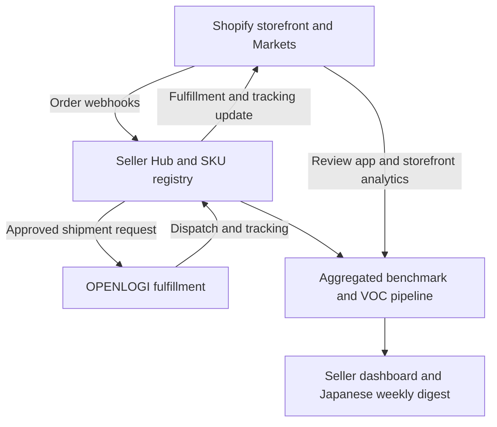

# Cross-Border Seller Hub

**Bring standout Japanese products to overseas customers.**

We build Shopify storefronts for Japanese tea and regional food producers and connect them with consumers through group-buy campaigns in Taiwan. We prepare product information for food imports and coordinate customs and delivery with Taiwanese importers, brokers, and carriers. After delivery, we share sales results and customer feedback with producers so they can improve their products.

The first pilot takes **Japanese tea to Taiwan**. It tests paid website development, a fee for running group buys, and a recurring service for improving sales.

| Document | What it covers |
| --- | --- |
| [Business plan](docs/business-plan.md) | Target customers, three revenue streams, Taiwan group-buy operations, unit economics, and the 90-day pilot |
| [Operating model and partner roles](docs/operating-model.md) | Recruitment and ordering, consolidated international shipping, individual delivery in Taiwan, and payments |
| [Website development and subsidies](docs/website-service-and-subsidies.md) | Package pricing, program eligibility, and work before and after a grant award |
| [Market feedback MVP](docs/market-feedback-mvp.md) | Traditional Chinese customer feedback, co-purchases, pricing tests, referral tracking, and success measures |

## Japanese tea multi-store analytics MVP

The [analytics dashboard](mvp/index.html) and [sample tea storefront](mvp/index.html#store) share a dataset. The interactive storefront represents one fictional shop, Uji Tsukino Tea House. Analytics match orders, shipments, and reviews by store and order ID across 36 fictional Shopify-style stores, including the sample shop.

Download the source and open `mvp/index.html` in a browser, or run `python3 -m http.server 8000` at the repository root and open `http://localhost:8000/mvp/`.

1. In **Sales analytics**, switch the market, period, and store to compare sales, delivery costs, and Taiwan group-buy orders.
2. In the **sample tea storefront**, add products to the cart and place a test order. For Taiwan, select the Taiwan group-buy sales channel. Then record a simulated delivery and review.
3. Use the link back to analytics to see the test order in store and market totals. In **Imported data**, inspect orders, shipping charges, and reviews and export the selected range as CSV.
4. In **AI insights**, review Traditional Chinese customer feedback, co-purchase denominators, price and shipping costs, and referral evidence. Record an action for the next campaign.

The demo uses a fixed seed to generate 7,696 fictional orders. The initial 30-day view contains 2,462 valid orders. Net merchandise sales exclude canceled and refunded orders. Freight ratios and the amount remaining after product and shipping costs use completed orders with actual freight costs. Rules recalculate the metrics and suggestions when inputs change. The storefront simulates checkout in the browser and saves test orders and actions in local storage.

The **Shopify import** screen can load test orders read from one Shopify development store by following the [read-only import guide](docs/shopify-test-import.md). Use the fictional sample option to try the screen without a store.

## D2C fulfillment sandbox

The existing Shopify × OPENLOGI demo illustrates parcel-level order consolidation and a U.S. test scenario. The Taiwan business pilot uses campaign-level demand aggregation with a local importer and seller.

### Try the prototype

Open [prototype/index.html](prototype/index.html) in a browser. It runs using embedded sample data and has no build step. If you prefer a local server, run this at the repository root and visit `http://localhost:8000/prototype/`.

```sh
python3 -m http.server 8000
```

1. In **Fulfillment**, open shipment **SH-101**. Orders **#1048** and **#1049** share a seller, customer, destination address, shipping service, duty treatment, and currency. The first order opens a 12-hour consolidation window. A later order for the same Seattle buyer appears in a separate parcel.
2. Open **Invoice preview** and check the English item descriptions, origin, tariff references, quantities, weights, and declared totals. Advance the demo clock to close the hold, then simulate dispatch. A single simulated tracking number is assigned to the parcel and its Shopify orders.
3. Open **SH-104** to see a regional condiment held for customs review. Use **SKU registry** to inspect the sample product records.
4. In **Benchmarks**, compare mock AOV, conversion, 60-day repeat rate, and freight-to-GMV ratios by market. Singapore demonstrates cohort suppression. The Japanese seller digest uses illustrative bundle, review, and freight findings.

The browser stores simulated dispatch and clock progress locally when storage is available. **Reset demo** restores the starting state. The prototype does not contact Shopify, OPENLOGI, customs, carriers, or an LLM. Its addresses, carrier estimates, tracking numbers, and merchant data are fictional.

### Proposed sandbox architecture



- **Storefront** — Local currencies, bundles, checkout contact details, and lane-specific DDP or DAP.
- **Seller Hub** — Validate SKU and customs metadata, use the earliest eligible order to start a 12-hour hold, consolidate matching orders within a seller, and calculate a route and parcel weight.
- **Fulfillment** — Verify OPENLOGI warehouse eligibility for food, lot and expiry controls, FEFO (first-expired, first-out), tracking, and invoice/waybill workflows for each carrier and service.
- **Analytics** — Compare anonymized category cohorts by market and period. Generate Japanese digests on co-purchases, multilingual review themes, and freight costs. Test pricing recommendations against seller margins.

#### Production integration rules

- Verify Shopify HTTPS webhook signatures on the raw body, deduplicate by shop and event ID, persist events before processing, and reconcile order edits, cancellations, and fulfillment changes. Pin a supported Admin GraphQL version. Use a single writer for warehouse requests to avoid native connector and middleware double dispatch. [Shopify webhook verification](https://shopify.dev/docs/apps/build/webhooks/verify-deliveries)
- Normalize structured addresses conservatively and match the customer ID, seller, complete address (including unit), fulfillment location, service, duty treatment, and currency. Keep orders with missing or ambiguous data separate pending review. Start a new group after 12 hours from the oldest order, rather than sliding the window. Revalidate paid state, stock, customs, and destination before dispatch.
- Persist one immutable external reference per warehouse shipment and reconcile that reference after ambiguous responses. After dispatch, update the Shopify fulfillment orders and line quantities belonging to that parcel with the shared tracking number. Treat partial failures and retries per order.
- Calculate declared value from validated line values after discounts, in the declared currency. Confirm chargeable weight, actual carrier fees, and the label's DDP/DAP setting before release. [Shopify customs and DDP guidance](https://help.shopify.com/en/manual/international/duties-and-import-taxes/additional-tasks)

### Sandbox metrics

The benchmark screen uses fictional cohorts. Any production use of cross-seller comparisons or AI training requires a review of permitted data sources and purposes. See the [market feedback specification](docs/market-feedback-mvp.md#data-and-decision-making).

| Metric | Proposed definition |
| --- | --- |
| Average order value (AOV) | Net merchandise sales divided by paid orders in the period |
| Conversion rate | Purchasing sessions divided by eligible storefront sessions, from storefront analytics |
| 60-day repeat rate | Share of first-time buyers ordering again within 60 days, using fully observed cohorts |
| Freight-to-GMV | Outbound carrier freight divided by net merchandise sales, in a shared reporting currency |

### Fast-track sandbox validation

Use the [sandbox setup and read-only access check](docs/sandbox-setup.md) to confirm both test environments first.

- [ ] **Shopify** — Create a dev store and use a supported test payment gateway. Configure the U.S. market, require a checkout shipping phone number, create consistent SKUs, and test a virtual bundle if the store and apps are eligible. Configure additional countries only after lane review. [Shopify dev stores](https://shopify.dev/docs/apps/build/stores/development-stores)
- [ ] **OPENLOGI** — Confirm access to a test environment and whether the Shopify app supports the dev store. Verify no-charge simulation, food warehouse acceptance, virtual stock, tracking callbacks, and whether external consolidation is supported. Mirror SKU IDs, English customs descriptions, origin, and tariff references. Keep carrier routing and dispatch in test mode.
- [ ] **End-to-end** — Place two paid test orders for the same Seattle destination within 12 hours. Verify only one warehouse request, the combined commercial invoice, tracking on both Shopify orders, and a separate parcel for orders outside the hold. Replay a webhook and repeat the test for an order cancellation and a missing phone number.
- [ ] **AI pilot** — Ingest approved aggregate orders, redacted reviews from the chosen review app, and reconciled freight costs. Generate a Japanese weekly digest with co-purchased SKUs, VOC themes, and freight-to-GMV alerts. Validate findings against underlying aggregate counts before release.

The 1–2 day target applies to prototype validation once test access and fees are confirmed. See [SKU and FDA checklist](docs/hs-codes-tea-food.md) and [shipping zones and rate assumptions](docs/shipping-zones.md).
