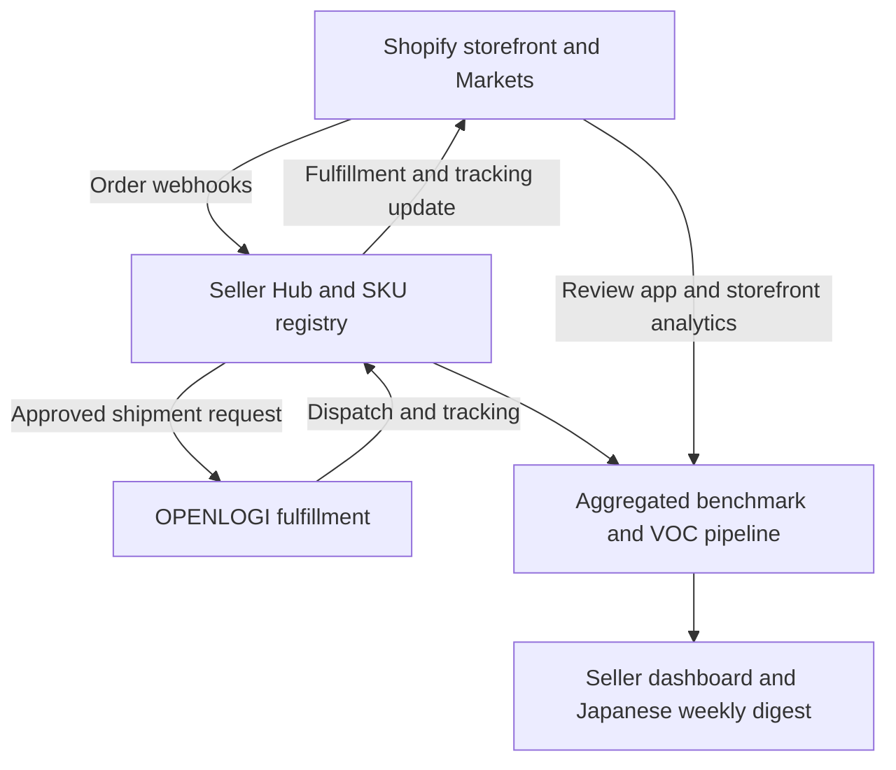

# Cross-Border Seller Hub

**日本のいい商品を、海外のお客様へ。**

日本茶・地域食品メーカー向けに、Shopifyで海外向け通販サイトを制作し、台湾の共同購入（團購）を通じて現地のお客様とつなぎます。物流・輸入販売パートナーと集荷からお届けまでを手配し、売れ行きとお客様の声を次の商品改善に活かせるよう、作り手へ返します。

最初の事業実証は**日本茶 → 台湾**。制作は受託費、團購は開催運営料、販売改善は継続契約を検証する。

| ドキュメント | 内容 |
| --- | --- |
| [事業計画](docs/business-plan.md) | 対象顧客、3段階の収益、台湾團購の商流、採算、90日間の検証 |
| [制作サービスと補助金](docs/website-service-and-subsidies.md) | 制作パッケージの見積もり、制度の対象条件、交付決定前後の進め方 |
| [市場フィードバックのMVP](docs/market-feedback-mvp.md) | 繁体字VOC、併買、価格テスト、参照元計測、次回の施策と判定指標 |

## 日本茶マルチストア分析 MVP

[分析ダッシュボード](mvp/index.html)と[お茶の販売サンプル](mvp/index.html#store)を追加。操作できる販売サイトは架空の「宇治 月野茶房」1店。分析では、この1店を含む架空のShopify想定36店の注文・配送・レビューを、店舗IDと注文IDで照合する。

ソースをダウンロードして `mvp/index.html` をブラウザーで開くか、リポジトリのルートで `python3 -m http.server 8000` を実行して `http://localhost:8000/mvp/` を開く。

1. **販売分析**で台湾などの市場、期間、店舗を切り替え、売上・配送費・台湾團購の注文を比較する。
2. **お茶の販売サンプル**で商品をカートに追加し、テスト注文を確定する。台湾向けは注文経路に「台湾團購」を選べる。続けて模擬配送とレビューを登録する。
3. **分析で確認する**から、テスト注文を含む店舗・市場の集計を見る。**取り込みデータ**で注文・送料・レビューを確認し、選択範囲のCSVを出力できる。
4. **AIインサイト**で繁体字VOC、併買の分母、価格と配送費、流入経路の根拠を見て、次回の施策を登録する。

初期データは固定シードで生成する7,696件の架空注文。初回表示の直近30日には2,462件の有効注文が含まれる。返金・取消は純商品売上から除外し、配送費率と商品原価・配送費控除後の額は実績配送費を持つ配送完了注文を対象にする。分析と提案は入力に応じてルールで再計算する。販売サンプルはブラウザー内の模擬決済で、テスト注文と施策はローカルストレージに保存する。

**Shopify取込**では、別途用意したShopify開発ストア1店のテスト注文を、[手順](docs/shopify-test-import.md)に沿って読み取り専用で取り込める。「架空サンプルを読み込む」で画面だけ試すこともできる。

## D2C fulfillment sandbox

The existing Shopify × OPENLOGI demo illustrates parcel-level order consolidation and a U.S. test scenario. The Taiwan business pilot uses campaign-level demand aggregation with a local importer and seller.

### Try the prototype

Open [prototype/index.html](prototype/index.html) in a browser. It runs using embedded sample data and has no build step. If you prefer a local server, run this at the repository root and visit `http://localhost:8000/prototype/`.

```sh
python3 -m http.server 8000
```

1. In **Fulfillment**, open shipment **SH-101**. Orders **#1048** and **#1049** share a seller, customer, destination address, shipping service, duty treatment, and currency. The first order opens a 12-hour consolidation window. A later order for the same Seattle buyer appears in a separate parcel.
2. Open **Invoice preview** and check the English item descriptions, origin, tariff references, quantities, weights, and declared totals. Advance the demo clock to close the hold, then simulate dispatch. A single simulated tracking number is assigned to the parcel and its Shopify orders.
3. Open **SH-104** to see a regional condiment held for customs review. Use **SKU registry** to inspect the sample product records.
4. In **Benchmarks**, compare mock AOV, conversion, 60-day repeat rate, and freight-to-GMV ratios by market. Singapore demonstrates cohort suppression. The Japanese seller digest uses illustrative bundle, review, and freight findings.

The browser stores simulated dispatch and clock progress locally when storage is available. **Reset demo** restores the starting state. The prototype does not contact Shopify, OPENLOGI, customs, carriers, or an LLM. Its addresses, carrier estimates, tracking numbers, and merchant data are fictional.

### Proposed sandbox architecture



- **Storefront** — Local currencies, bundles, checkout contact details, and lane-specific DDP or DAP.
- **Seller Hub** — Validate SKU and customs metadata, use the earliest eligible order to start a 12-hour hold, consolidate matching orders within a seller, and calculate a route and parcel weight.
- **Fulfillment** — Verify OPENLOGI warehouse eligibility for food, lot and expiry controls, FEFO (first-expired, first-out), tracking, and invoice/waybill workflows for each carrier and service.
- **Analytics** — Compare anonymized category cohorts by market and period. Generate Japanese digests on co-purchases, multilingual review themes, and freight costs. Test pricing recommendations against seller margins.

#### Production integration rules

- Verify Shopify HTTPS webhook signatures on the raw body, deduplicate by shop and event ID, persist events before processing, and reconcile order edits, cancellations, and fulfillment changes. Pin a supported Admin GraphQL version. Use a single writer for warehouse requests to avoid native connector and middleware double dispatch. [Shopify webhook verification](https://shopify.dev/docs/apps/build/webhooks/verify-deliveries)
- Normalize structured addresses conservatively and match the customer ID, seller, complete address (including unit), fulfillment location, service, duty treatment, and currency. Keep orders with missing or ambiguous data separate pending review. Start a new group after 12 hours from the oldest order, rather than sliding the window. Revalidate paid state, stock, customs, and destination before dispatch.
- Persist one immutable external reference per warehouse shipment and reconcile that reference after ambiguous responses. After dispatch, update the Shopify fulfillment orders and line quantities belonging to that parcel with the shared tracking number. Treat partial failures and retries per order.
- Calculate declared value from validated line values after discounts, in the declared currency. Confirm chargeable weight, actual carrier fees, and the label's DDP/DAP setting before release. [Shopify customs and DDP guidance](https://help.shopify.com/en/manual/international/duties-and-import-taxes/additional-tasks)

### Sandbox metrics

The benchmark screen uses fictional cohorts. Any production use of cross-seller comparisons or AI training requires a review of permitted data sources and purposes. See the [market feedback specification](docs/market-feedback-mvp.md#データと判断).

| Metric | Proposed definition |
| --- | --- |
| Average order value (AOV) | Net merchandise sales divided by paid orders in the period |
| Conversion rate | Purchasing sessions divided by eligible storefront sessions, from storefront analytics |
| 60-day repeat rate | Share of first-time buyers ordering again within 60 days, using fully observed cohorts |
| Freight-to-GMV | Outbound carrier freight divided by net merchandise sales, in a shared reporting currency |

### Fast-track sandbox validation

Use the [sandbox setup and read-only access check](docs/sandbox-setup.md) to confirm both test environments first.

- [ ] **Shopify** — Create a dev store and use a supported test payment gateway. Configure the U.S. market, require a checkout shipping phone number, create consistent SKUs, and test a virtual bundle if the store and apps are eligible. Configure additional countries only after lane review. [Shopify dev stores](https://shopify.dev/docs/apps/build/stores/development-stores)
- [ ] **OPENLOGI** — Confirm access to a test environment and whether the Shopify app supports the dev store. Verify no-charge simulation, food warehouse acceptance, virtual stock, tracking callbacks, and whether external consolidation is supported. Mirror SKU IDs, English customs descriptions, origin, and tariff references. Keep carrier routing and dispatch in test mode.
- [ ] **End-to-end** — Place two paid test orders for the same Seattle destination within 12 hours. Verify only one warehouse request, the combined commercial invoice, tracking on both Shopify orders, and a separate parcel for orders outside the hold. Replay a webhook and repeat the test for an order cancellation and a missing phone number.
- [ ] **AI pilot** — Ingest approved aggregate orders, redacted reviews from the chosen review app, and reconciled freight costs. Generate a Japanese weekly digest with co-purchased SKUs, VOC themes, and freight-to-GMV alerts. Validate findings against underlying aggregate counts before release.

The 1–2 day target applies to prototype validation once test access and fees are confirmed. See [SKU and FDA checklist](docs/hs-codes-tea-food.md) and [shipping zones and rate assumptions](docs/shipping-zones.md).
