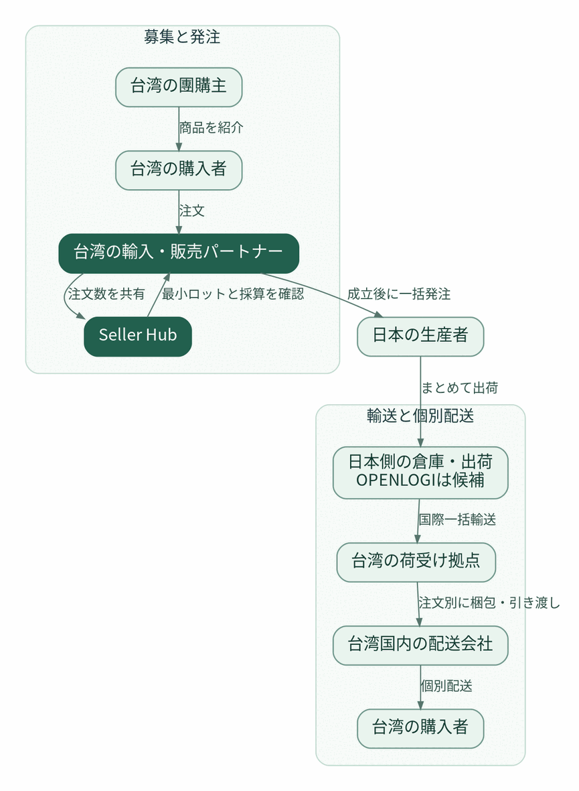

# Operating Model and Partner Roles

The first campaign offers one Japanese tea set to the existing communities of two Taiwanese group-buy organizers. Seller Hub builds the product page on Shopify or a similar platform, coordinates the local sales pilot, and reports results.

## Before recruitment and at shipment

- **Before the first campaign for a SKU:** Seller Hub gathers ingredients, manufacturer and origin details, and packaging labels. The Taiwanese importer and broker confirm acceptance, labeling and document requirements, cost, and timing before recruitment.
- **For each shipment:** Seller Hub coordinates the handoff and tracks status. The registered Taiwanese food importer authorizes the broker or carrier's brokerage team to file the import declaration and food inspection application. The authority determines whether sampling is needed. [Taiwan FDA import inspection rules](https://www.fda.gov.tw/ENG/lawContent.aspx?cid=5094&id=3068)
- **For repeat campaigns:** Reuse the product file, reconfirm changes, and make the required shipment filings. Seller Hub includes preparation and coordination in its operating fee. Brokerage, inspection filing, any testing and storage, and delivery costs are quoted separately.

## Order and shipping flow



<details>
<summary>Editable Mermaid source</summary>

```text
flowchart TD
  subgraph A["Recruitment and ordering"]
    L["Taiwanese group-buy organizer"] -->|"Promotes the set"| C["Buyers in Taiwan"]
    C -->|"Place orders"| T["Taiwanese import and retail partner"]
    T -->|"Shares order totals"| H["Seller Hub"]
    H -->|"Checks minimum quantity and margin"| T
  end
  T -->|"Places a bulk order once the campaign qualifies"| P["Japanese producer"]
  subgraph B["Shipping and last-mile delivery"]
    P -->|"Ships the batch"| J["Warehousing and dispatch in Japan"]
    J -->|"Consolidated international shipment"| W["Receiving hub in Taiwan"]
    W -->|"Packs individual orders and hands them over"| D["Taiwanese delivery carrier"]
    D -->|"Delivers each parcel"| R["Buyers in Taiwan"]
  end
```

</details>

- The Taiwanese import and retail partner accepts orders and payments. It pools orders across groups, checks the minimum quantity and margin, and places a bulk order when the campaign qualifies. It also handles refunds if the campaign falls short.
- **The receiving hub in Taiwan is the handoff to local delivery.** OPENLOGI is a candidate for warehousing and dispatch in Japan. Assign an international carrier for the shipment. The Taiwanese retail partner leads import and receiving and arranges local delivery for each order.
- Track costs, schedules, and tracking numbers separately for the consolidated international shipment and local deliveries in Taiwan.

## Payments and fees


<details>
<summary>Editable Mermaid source</summary>

```text
flowchart TD
  C["Buyers in Taiwan"] -->|"Product and delivery charges"| T["Taiwanese import and retail partner"]
  T -->|"Wholesale payment"| P["Japanese producer"]
  T -->|"Campaign compensation"| L["Taiwanese group-buy organizer"]
  T -->|"Operating fee for completed deliveries"| H["Seller Hub"]
  T -->|"Actual shipping and delivery costs"| F["Shipping and delivery providers"]
  P -->|"Shopify and website development fee"| H
```

</details>

This is the proposed settlement flow for Taiwan. Confirm the contracting party and payer for each shipping leg before ordering. The Taiwanese retail partner handles customer payments and refunds. Seller Hub earns the campaign operating fee on sets that are delivered and never refunded. Test a separate monthly plan for ongoing sales improvements after the second paid campaign and a review of the results.

| Partner | Role |
| --- | --- |
| **Seller Hub** | Build Shopify or other international product pages, prepare product files, coordinate food import filings, campaign thresholds, and delivery dates, reconcile settlement data, and propose improvements for the next campaign. |
| **Japanese producer** | Provide product information, wholesale pricing, minimum order quantities, and stock or production capacity. Ship the agreed quantity once the campaign qualifies. |
| **Taiwanese group-buy organizer** | Introduce the product and recruit buyers. If an organizer also handles delivery, agree on the scope and responsibilities before launch. |
| **Warehouse and international shipping providers** | Collect, store, and pack products and ship the consolidated batch. Assign each provider a leg. |
| **Taiwanese import and retail partner** | Manage imports and receiving, orders and payments, local delivery arrangements, inquiries, returns, and refunds. |
| **Customs broker or carrier's brokerage team** | File the import declaration and food inspection application under the importer's authorization and coordinate official sampling if required. |
| **Taiwanese delivery carrier** | Deliver individual parcels and provide tracking and initial incident reports. |

After each campaign, Seller Hub receives order and delivery results and authorized customer feedback from Taiwan. It reports product-level profitability and the next proposed action to the Japanese producer. [Business plan and unit economics](business-plan.md) · [Market feedback MVP](market-feedback-mvp.md)
