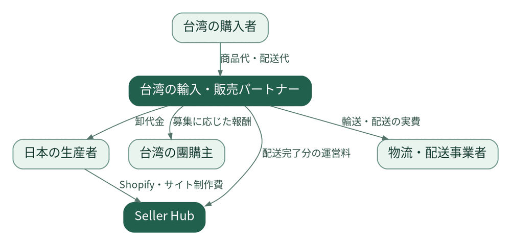

# ビジネスモデルとパートナーの役割

初回は日本茶のセット1種類を、台湾の團購主2人の既存コミュニティで募集する。Seller HubはShopify等での商品紹介ページ制作から、現地でのテスト販売の調整、結果の報告までを担う。

## 注文と荷物の流れ


<details>
<summary>編集用のMermaidコード</summary>

```text
flowchart TD
  subgraph A["募集と発注"]
    L["台湾の團購主"] -->|"商品を紹介"| C["台湾の購入者"]
    C -->|"注文"| T["台湾の輸入・販売パートナー"]
    T -->|"注文数を共有"| H["Seller Hub"]
    H -->|"最小ロットと採算を確認"| T
  end
  T -->|"成立後に一括発注"| P["日本の生産者"]
  subgraph B["輸送と個別配送"]
    P -->|"まとめて出荷"| J["日本側の倉庫・出荷"]
    J -->|"国際一括輸送"| W["台湾の荷受け拠点"]
    W -->|"注文別に梱包・引き渡し"| D["台湾国内の配送会社"]
    D -->|"個別配送"| R["台湾の購入者"]
  end
```

</details>

- 台湾の輸入・販売パートナーが注文と決済を受け付ける。グループごとの注文を合算し、最小ロット・採算条件を照合してから発注する。募集が成立しない場合の返金も台湾の販売パートナーが担当する。
- **台湾の荷受け拠点で物流を引き継ぐ。** OPENLOGIは日本側の倉庫・出荷の候補。国際輸送は担当事業者を決め、台湾の販売パートナーが輸入手続きと荷受けを主導する。個別配送は台湾側が注文ごとに手配する。
- 国際一括輸送と台湾国内配送は、費用・納期・追跡番号を分けて管理する。

## 決済と報酬の流れ



<details>
<summary>編集用のMermaidコード</summary>

```text
flowchart TD
  C["台湾の購入者"] -->|"商品代・配送代"| T["台湾の輸入・販売パートナー"]
  T -->|"卸代金"| P["日本の生産者"]
  T -->|"募集に応じた報酬"| L["台湾の團購主"]
  T -->|"配送完了分の運営料"| H["Seller Hub"]
  T -->|"輸送・配送の実費"| F["物流・配送事業者"]
  P -->|"Shopify・サイト制作費"| H
```

</details>

台湾での取引精算の想定を示す。物流の区間ごとの契約先と支払主体は発注前に確認する。台湾の販売パートナーが現地購入者の決済と返金を担当する。Seller Hubの開催運営料は配送完了かつ返金のないセットが対象。販売改善の継続支援は、第2回の有料開催と施策の結果を確認してから、別途月額プランを検証する。

| 担当 | 提供・担当すること |
| --- | --- |
| **Seller Hub** | Shopify・海外向け商品ページの制作、成立条件・納期の調整、精算データの照合、次回の改善提案 |
| **日本の生産者** | 商品情報、卸価格、最低ロット、在庫・製造枠の提示、成立後の出荷 |
| **台湾の團購主** | 商品の紹介と募集。配送まで担当する案件では作業範囲と責任を募集前に合意する。 |
| **日本側の倉庫・国際輸送事業者** | 集荷・保管・梱包、一括輸送。事業者ごとに担当区間を決める。 |
| **台湾の輸入・販売パートナー** | 輸入手続きと荷受け、注文・決済、配送手配、購入者の問い合わせ・返品・返金 |
| **台湾国内の配送会社** | 購入者への個別配送、追跡と配送事故の一次情報 |

開催後は、台湾側から注文・配送の実績と許諾済みの顧客の声を受け取り、Seller Hubが商品別の採算と次回試す施策を日本の生産者へ返す。 [事業計画と採算の仮試算](business-plan.md) · [販売結果のMVP仕様](market-feedback-mvp.md)
